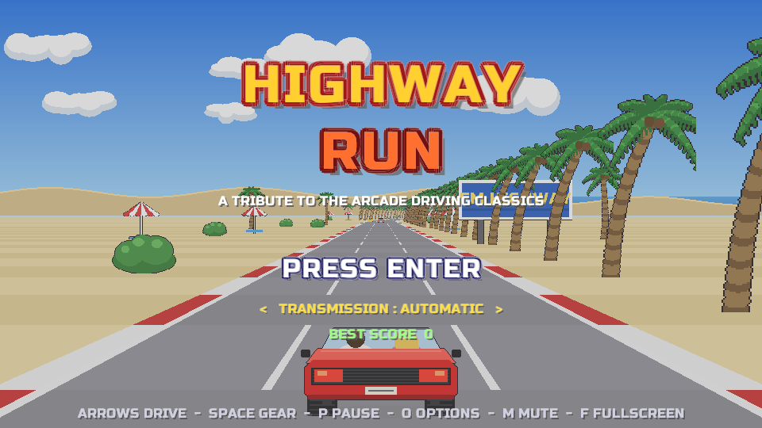

# HighwayRun

[](https://github.com/ymauray/highwayrun/actions/workflows/build.yml)
[](https://github.com/ymauray/repocheck)



Recréation d'un jeu de course arcade des années 80 (voir [CONCEPT.md](CONCEPT.md)) en .NET 10, avec
[raylib-cs](https://github.com/ChrisDill/Raylib-cs). Tout est généré au démarrage — sprites, décors,
musiques et bruitages : le dépôt ne contient aucun fichier graphique ou sonore. Seule exception, la police
[Russo One](https://fonts.google.com/specimen/Russo+One) (SIL Open Font License, voir
`assets/fonts/OFL.txt`), embarquée dans le binaire.

## Jouer

Les binaires pour Windows, Linux et macOS (Apple Silicon et Intel) sont attachés à chaque
[release](https://github.com/ymauray/highwayrun/releases) ; ceux de la branche `main` sont disponibles
comme artefacts du workflow [Build](https://github.com/ymauray/highwayrun/actions/workflows/build.yml).
Chaque binaire est un fichier unique qui embarque tout ce qu'il faut : aucun runtime .NET à installer.

Sur macOS, le binaire n'est pas signé : après l'avoir téléchargé, retirer l'attribut de quarantaine avec
`xattr -d com.apple.quarantine highwayrun`.

Depuis les sources (SDK .NET 10) :

```sh
dotnet run
```

| Action | Clavier | Manette |
|-|-|-|
| Accélérer / freiner | ↑ / ↓ | A ou RT / X ou LT |
| Tourner | ← / → | stick gauche, croix |
| Changer de vitesse (boîte manuelle) | Espace | RB ou B |
| Pause / quitter vers le titre | P ou Échap / Q | Start |
| Volumes de la musique et des bruitages | O (écran titre ou pause) | Y |
| Plein écran / couper le son | F (ou F11, ⌥ Entrée) / M | |

Sur l'écran titre, ← → choisit la boîte automatique ou manuelle ; on choisit ensuite la musique à la radio.

Le temps est limité : chaque checkpoint en rajoute. À la fin de chaque étape la route se sépare en deux —
gauche ou droite — pour l'une des cinq arrivées (A à E), chacune avec sa scène de fin.

## Publier un binaire autonome

Le binaire embarque le framework .NET et la bibliothèque native raylib :

```sh
dotnet publish -c Release -r osx-arm64 -o publish/osx-arm64   # ou osx-x64, linux-x64, win-x64
```

## Intégration continue et releases

Tout passe par le workflow GitHub Actions [`build.yml`](.github/workflows/build.yml), sans outil externe :

- à chaque push sur `main` et chaque pull request, il publie le binaire autonome pour `linux-x64`, `win-x64`,
  `osx-arm64` et `osx-x64`, et le dépose comme artefact du run ;
- sur un tag `vX.Y.Z` (par exemple `git tag v1.0.0 && git push origin v1.0.0`), il crée en plus la release
  GitHub correspondante, avec les quatre archives et des notes générées à partir des PR.

Le binaire n'est ni signé ni notarié : aucune étape de signature n'existe, ni dans la CI ni ailleurs.

## Organisation

| Fichier | Rôle |
|-|-|
| `src/Game.cs` | écrans, physique de la voiture, trafic, HUD |
| `src/Track.cs` | segments de route, génération des étapes et des fourches |
| `src/Renderer.cs` | projection pseudo-3D, route, sprites, parallaxe |
| `src/Themes.cs` | les 15 étapes : palettes, décors, caractère du tracé |
| `src/Art.cs`, `src/Backdrops.cs` | sprites et arrière-plans dessinés procéduralement |
| `src/Audio.cs` | synthèse du moteur, des bruitages et des trois morceaux |
| `src/Endings.cs` | les cinq scènes de fin |

`highwayrun --shots <dossier>` joue une partie en pilote automatique et enregistre des captures d'écran,
pratique pour vérifier le rendu sans jouer.
